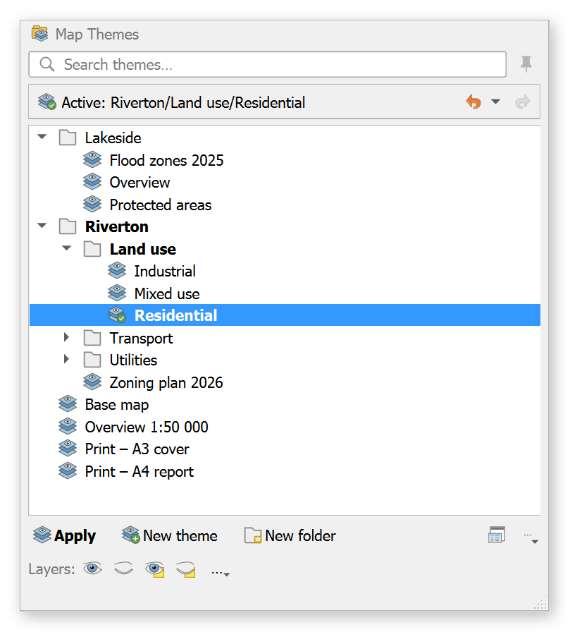
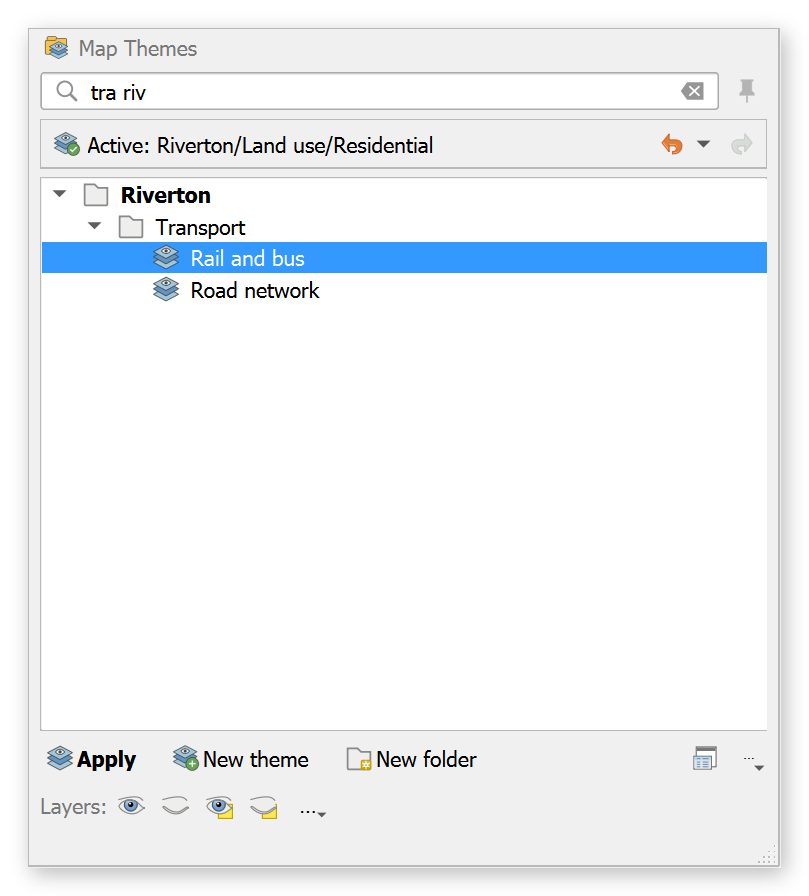
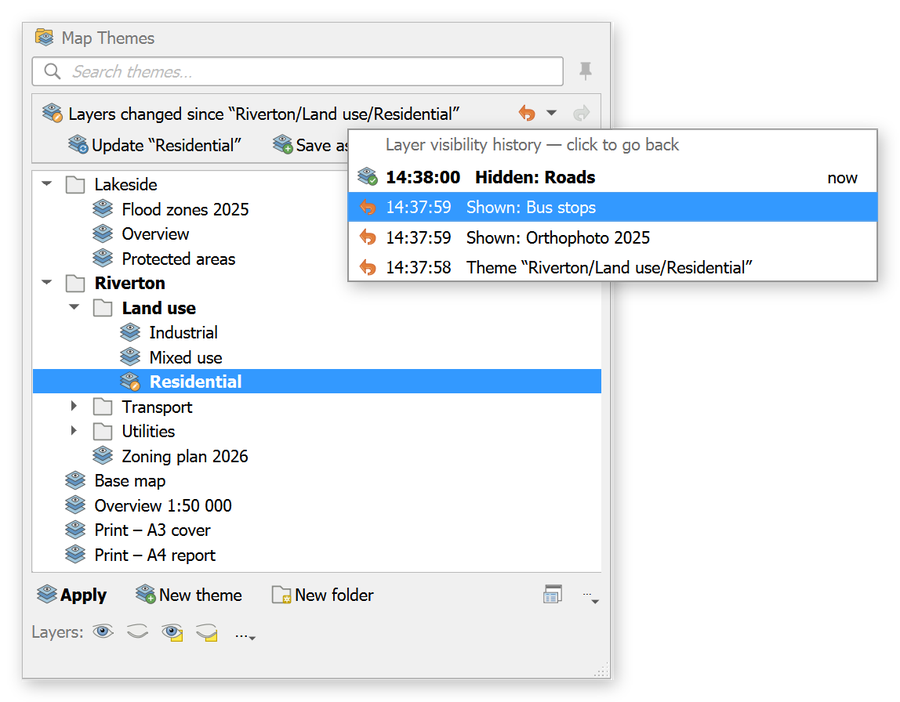
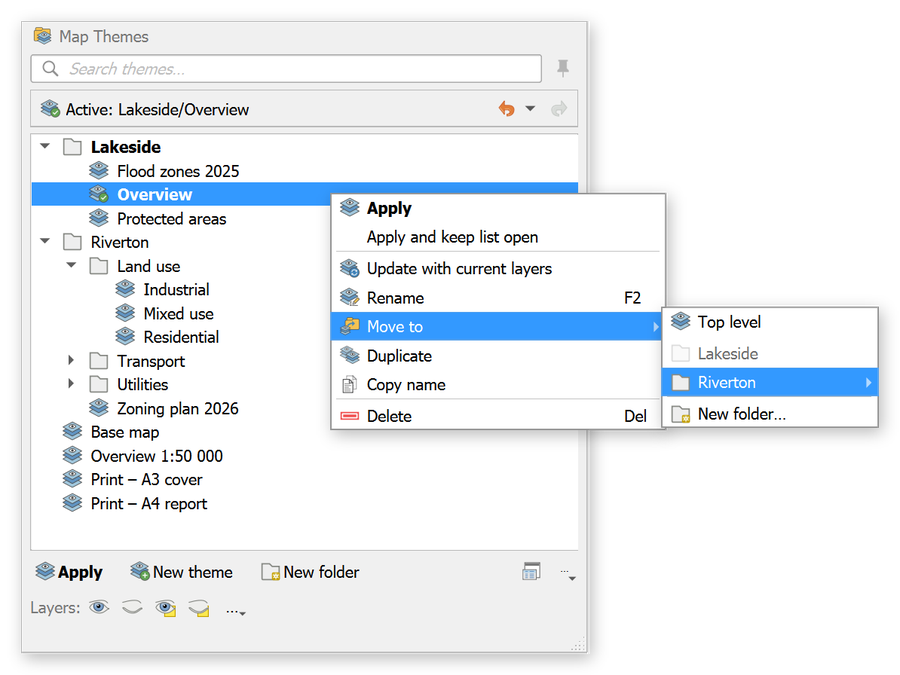
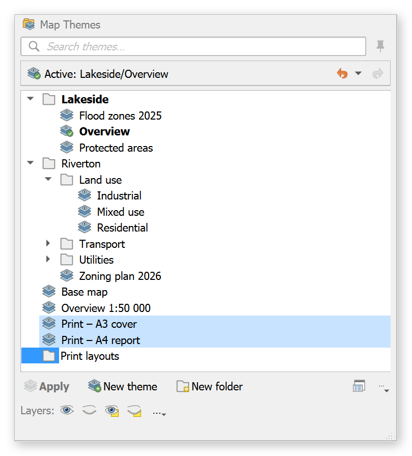

# Map Themes Evolved


A QGIS plugin that turns the eye button in the Layers panel ("Manage Map Themes") into a searchable, folder-based theme browser. It stays fully compatible with native QGIS map themes.

Folders are just part of the theme name: `Riverton/Land use/Residential` shows up as `Residential` in the folders `Riverton ▸ Land use`. Nothing else is stored, so a project opened without the plugin behaves exactly as before. You just see the full names in the flat list.

<p align="center"></p>

## Screenshots

*(Demo project with made-up names.)*

| Search: words in any order | Layers changed → Update, or undo layer visibility |
|---|---|
|  |  |
| **Right-click: Move to a folder, rename, duplicate…** | **Group selected themes: type the folder name in place** |
|  |  |

## Using it

Click the **eye button** in the Layers panel.

- **Click** selects (Ctrl/Shift+click selects several). **Double-click**, **Enter** or the **Apply** button applies a theme, so a stray click never changes your map.
- **Type** to search. Words can be in any order, and case and accents are ignored (`viz telek` finds `Vizsgálat - Telekméretek`). Press **Enter** to apply the best match.
- The **status line** shows the active theme. If you changed layers since applying a theme, it says so and offers **Update** (overwrite that theme) and **Save as new…**.
- **Right-click** a theme or folder for everything else: update, rename, **Move to ▸**, duplicate, copy name, delete, and new theme or subfolder here.
- **Drag** themes or folders onto a folder to move them, or onto empty space to move them to the top level.
- **Group:** select several themes, then press **Group…** (or Ctrl+G, or right-click) and type the folder name right in the list. The items move into it, and the new folder appears where the first of them was. Typing an existing folder's name moves them into that folder.
- **Undo layer visibility:** the **↶** button next to the status line (or **Ctrl+Z**) steps the layer checkboxes back one change, and **↷** (Ctrl+Y) redoes. This undoes an accidental *Hide All*, a mis-click in the Layers panel, or applying the wrong theme. The **▾** arrow lists the last 30 states (e.g. "Hidden: roads", "Theme “X”") to jump to directly. Your saved themes are never changed by this. The history is saved with the project, so you can still undo after reopening it. The actions are also in *Plugins ▸ Map Themes Evolved*, where you can give them global shortcuts.
- **Reorder:** drag a folder or theme *between* rows to put it there. Dropping *onto* a folder moves the item into it. Folders and themes can be mixed in any order, like in the Layers panel, and dropping on the empty space below the list moves an item to the end. The custom order is saved in the project (see Compatibility); anything you haven't placed keeps natural sorting.
- **New theme** and **New folder** add a row you type the name into. Type `Area/Topic/Name` to create subfolders on the fly.
- **Theme edits** (rename, move, group, delete, reorder…) can be undone from the message bar's *Undo* link or *⋯ ▸ Undo last theme edit*.
- **Open as panel** (window icon) docks the same browser beside the map, which is handy for longer organising sessions.
- **Window position and size:** drag the popup by its title bar and it reopens there. Resize it by dragging its left, right or bottom edge, or the bottom-right corner. Double-click the title bar to put it back under the eye button. The popup and panel positions are saved in your QGIS settings, not the project. If a monitor is unplugged or the resolution changes, they're moved back onto a visible screen.
- The **Layers:** row holds QGIS's own Show All / Hide All / Show Selected… actions, unchanged. The less common ones (Toggle Selected Layers, Hide Deselected Layers…) are in the **⋯** menu.
- **Right-click the eye button**, or use *⋯ ▸ Classic QGIS map themes menu*, for the original menu.

| Key | Action |
|---|---|
| type | search |
| ↑ / ↓ | move through the list |
| Enter, double-click | apply theme (and close the popup) |
| Ctrl+Enter, middle-click | apply theme and keep the list open (or use 📌) |
| Ctrl/Shift+click | select several |
| Ctrl+G | group the selection into a folder |
| Ctrl+Z / Ctrl+Y | undo / redo layer visibility |
| F2 (or right-click ▸ Rename) | rename in place |
| Del | delete the selection, no confirmation box (Undo brings it back) |
| Esc | clear the search, then close |

You can assign a shortcut to *Browse Map Themes…* in *Settings ▸ Keyboard Shortcuts*.

## Compatibility

- Reads and writes only through QGIS's own map-theme API (`QgsMapThemeCollection`).
- Renames use `renameMapTheme`, so **print layouts that follow a theme are updated by QGIS itself**. Data-defined theme expressions are *not* updated by QGIS. Check those after renaming.
- The plugin stores three extra things in the project, as project properties that QGIS without the plugin ignores:
  - your **custom order** (`MapThemesEvolved/order`), once you reorder something;
  - which **folders are open or closed** (`MapThemesEvolved/expanded`), so the tree looks the same when you (or a colleague) open the project again. Opening or closing a folder therefore marks the project as changed; it's saved with the next project save.
  - the **layer visibility history** (`MapThemesEvolved/history`, the last 30 states, compressed), so ↶ / ↷ still work after you close and reopen the project. Nothing is written until there is something to undo.
- Window positions are never stored in the project; they're in your QGIS settings. The undo list for theme edits (rename, move, delete…) lasts only for the session.
- Disabling the plugin restores the original eye-button menu immediately.

Tested on QGIS 3.44 (Qt5). It's written to also work on QGIS 4.x (Qt6), but that hasn't been tested yet.

## Install

From a release: download `map_themes_evolved-<version>.zip` from [Releases](https://github.com/danzig666/qgis-map-themes-evolved/releases). In QGIS, open *Plugins ▸ Manage and Install Plugins ▸ Install from ZIP*.

For development, link the plugin folder into your profile (PowerShell):

```powershell
New-Item -ItemType Junction -Path "$env:APPDATA\QGIS\QGIS3\profiles\default\python\plugins\map_themes_evolved" -Target "<repo>\map_themes_evolved"
```

## Tests

```bash
python -m pytest map_themes_evolved/test -q
```

## Layout

```
map_themes_evolved/
├── core/paths.py      pure-Python name/folder/sort/search logic (unit-tested)
├── core/service.py    the only code touching QgsMapThemeCollection
├── core/undo.py       undo stack
├── hook/eye_button.py find, hook and restore the Layers-panel eye button
├── ui/                tree model, browser widget, popup, dock, dialogs
├── icons/             plugin icons (generated from assets/icon_sheet.png)
scripts/build_zip.py           builds the release zip
scripts/screenshots/           regenerates the README screenshots from a demo project
└── plugin.py          wiring
```

See [PLAN.md](PLAN.md) for the design and roadmap.

## License

Copyright (C) 2026 danzig666

This program is free software: you can redistribute it and/or modify it under the terms of the GNU General Public License as published by the Free Software Foundation, either **version 2 of the License, or (at your option) any later version** (SPDX: `GPL-2.0-or-later`). See [LICENSE](LICENSE).
